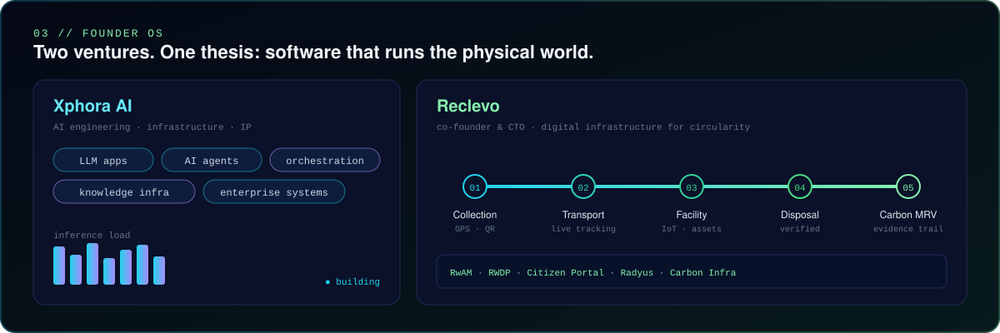

<!-- ============ HERO ============ -->
<p align="center">
  
</p>

<p align="center">
  <a href="https://readme-typing-svg.demolab.com">
    
  </a>
</p>

<!-- ============ QUICK LINKS ============ -->
<p align="center">
  <a href="https://skydeep.in"></a>
  <a href="mailto:aakashdeep0551@gmail.com"></a>
  <a href="https://www.linkedin.com/in/aakashdeep-srivastava"></a>
  <a href="https://github.com/Aakashdeep-Srivastava"></a>
</p>

<p align="center">
  
  
  
</p>

---

## 👋 Hire me — AI Engineer who ships end-to-end

I'm **Aakashdeep Srivastava**, an **AI Engineer with 5+ years** taking ML systems from **research → production**: LLM orchestration, real-time computer vision, and high-throughput Python microservices. I don't stop at a notebook — I ship **sub-40ms inference on serverless GPU**, with reproducible Poetry environments, A/B deployment gates, and drift monitoring.

> **Looking for:** AI / ML Engineer · LLM & Agentic Systems · Computer Vision · MLOps — full-time, end-to-end ownership.

- 🏗️ **Chief AI Engineer @ Reclevo Infotech** — building AI + logistics infra for circular-economy waste systems
- 🎓 **B.S. Data Science & Mechanical Engineering @ IIT Madras** — CGPA **8.9/10**
- 📜 **Azure Data Scientist Associate (DP-100)** · **Microsoft Data Analyst (PL-300)** · **MLOps Specialization**
- 🏆 **5× hackathon winner** · ranked **2nd / 900 teams** at Karnataka State Police Datathon
- 🌐 Portfolio & writing → **[skydeep.in](https://skydeep.in)**

---

## 🧠 How I think about AI systems

<p align="center">
  
</p>

**Specialised agents. Shared memory. Human in the loop.** I build agentic systems where an orchestrator plans, routes, and verifies across tool-using agents backed by RAG — and a human stays in the approval loop. In production this cut **Level-1 support tickets by 60%** (OpenAI + Gemini agentic workflows at Reclevo).

---

## 🔧 What I build

<p align="center">
  
</p>

| Domain | Stack I ship with | Proof |
|:--|:--|:--|
| **LLM & Agentic AI** | LangGraph · LangChain · Google ADK · Gemini / OpenAI / Anthropic APIs · multi-agent RAG · ChromaDB · Pinecone | 60% fewer L1 tickets · PII firewall + prompt-injection defense |
| **Real-time Computer Vision** | YOLO11-Seg · TensorRT INT8 · SAM 2 · Moondream2 (VLM) · OpenCV · PyTorch | **84% field accuracy @ <40ms**, 400+ images/day on Modal GPU |
| **LLM Fine-tuning / MLOps** | PEFT · QLoRA · 4-bit quant · Optuna · SageMaker · MLflow · DVC · W&B · Poetry | Qwen-3B at **95% baseline MMLU, −60% GPU memory** across 100+ models |
| **High-throughput services** | FastAPI · Celery · Redis · Kafka · WebSocket · GoLang (Gin) · Docker · GitHub Actions | 50+ concurrent requests · **98% viseme accuracy** · 99.9% uptime |
| **Serverless GPU inference** | Modal · AWS Lambda / SageMaker / S3 / EC2 · Azure ML / App Service / DevOps | sub-40ms latency, reproducible pipelines |

---

## 💼 Experience

### 🧪 Chief AI Engineer — Reclevo Infotech `Jun 2025 – Present` · Goa, India
End-to-end AI + logistics platform for rapid waste disposal.
- **Waste-segregation ML pipeline**: YOLO11-Seg + TensorRT INT8 → **84% field accuracy at <40ms**, SAM 2 auto-labeling, Moondream2 VLM fallback for ambiguous classes. Deployed on **Modal serverless GPU**, 400+ images/day.
- Shipped **Reclevo** — a Rapid Waste Disposal Platform serving **5 user roles** across multiple **React Native** frontends on a **GoLang (Gin)** microservices backend at **99.9% uptime**.
- Optimised fleet logistics (SWAM) with data-driven routing → **−25% fuel**, faster pickup turnaround.
- Built a **Pandas + NumPy ETL pipeline** over GPS telemetry (route optimization, heatmaps, anomaly detection).
- **Agentic workflows** (OpenAI + Gemini) for support & waste categorization → **−60% L1 tickets**; Power Automate compliance flows → **−95% manual entry errors**.

### 🤖 AI Engineer — EduGorilla Community `Jun 2024 – Sept 2025`
MLOps · PEFT · FastAPI · AWS
- **PEFT/QLoRA fine-tuning** of **Qwen-3B** on SageMaker — 4-bit quant + gradient checkpointing + Optuna sweeps → **95% of baseline MMLU at −60% GPU memory** vs full fine-tuning.
- Built an **MLflow evaluation pipeline** with **A/B deployment gates** and Poetry-standardized, reproducible envs → experiment tracking across **100+ models**.
- Architected a **FastAPI + Celery video-generation pipeline** (Gemini Pro + ElevenLabs + Rhubarb Lip Sync), Redis broker, **50+ concurrent requests at 98% viseme accuracy**, Docker + Prometheus health checks.
- Automated exam-notification ETL (SmartScraper AI + Pandas) → **1000+ notifications/day at 99% accuracy, +40% engagement**.

---

## 🚀 Flagship projects

### 🗳️ [Roothscale](https://roothscale.com) — Political Intelligence Platform
`Next.js 15 · NestJS 11 · PostgreSQL 16 + PostGIS · Python FastAPI · Anthropic API`
AI-powered election intelligence for Goa MLAs: booth-level analysis from public Form 20, an **AI Co-Pilot** with daily confidence-scored, evidence-backed recommendations, an **OR-Tools visit optimizer**, and a grievance CRM. Multi-tenant with **RLS forced**, **6 BullMQ worker pipelines** (z-score/EWMA early-warning, Apify social scanning), OCR ingest via Sarvam Vision — all behind a **PII firewall with prompt-injection defense**. *Deterministic SQL scoring; the LLM only writes explanations, never numbers.*

### 🧏 [EduMate](https://xedumate.vercel.app) — Multi-Modal Learning Platform · `Top 10 · Hack2Skill AI for Impact`
Real-time **sign-language recognition** (CNN image classification + object detection, **95% accuracy**) with **emotion detection** for autism support, plus **speech-to-image** generation (500+ voice commands, 90% satisfaction). Node.js/Express + WebSocket backend handling **100+ concurrent video streams at <100ms latency**.

### 🏪 [MSMEMate](https://msmemate.com) — Sovereign AI for ONDC Onboarding · `IndiaAI Challenge`
**DPDP-Act-2023-compliant, zero foreign LLM calls.** Three modules: **Sathi** (voice-first registration via Sarvam ASR/TTS), **VargBot** (TF-IDF + Sarvam-30B classifier, 14 ONDC domains, **98.5% accuracy**), **JodakAI** (multi-factor scoring, **NDCG@3 0.879**). Next.js 15 + FastAPI + PostgreSQL 16 + Redis, full **DVC pipeline** with model registry + drift monitoring and an immutable audit trail.

### 🚔 Police PRM — Performance & Resource Management · `2nd / 900 · Karnataka Datathon 2.0`
PowerBI analytics + Redis async queue over **50+ police stations** → **−60% resource-allocation time, −40% response time**; Airtable real-time tracking of **1000+ daily updates**, −80% manual entry, 5-minute decision cycles.

---

## 📊 Impact at a glance

<div align="center">

| Metric | Result | Where |
|:--|:--|:--|
| ⚡ CV inference latency | **< 40 ms** @ 84% field accuracy | Reclevo (YOLO11-Seg + TensorRT) |
| 🧠 Fine-tuning efficiency | **−60% GPU memory**, 95% baseline MMLU | EduGorilla (Qwen-3B QLoRA) |
| 🤖 Support automation | **−60% L1 tickets** | Reclevo agentic workflows |
| 🎬 Concurrency | **50+ req** @ 98% viseme accuracy | EduGorilla video pipeline |
| 🏭 Uptime | **99.9%** across 6 user personas | Reclevo GoLang microservices |
| 🏆 Competition | **2nd / 900 teams** · 5× winner | Hackathons & datathons |

</div>

---

## 🛠️ Tech stack


```text
Languages / OOP     Python (async, dataclasses) · GoLang · SQL · TypeScript · Pandas · NumPy · Polars
LLM & Agentic AI    LangGraph · LangChain · Google ADK · Gemini / OpenAI / Anthropic · RAG · ChromaDB · Pinecone
ML / DL / CV        PyTorch · TensorFlow · YOLO11-Seg · TensorRT · SAM 2 · Moondream2 VLM · PEFT / QLoRA · OpenCV
Pipelines           FastAPI · Flask · Celery · Redis · Kafka · WebSocket · Poetry · Docker Compose · CI/CD
Cloud & MLOps       AWS (SageMaker / Lambda / S3 / EC2) · Azure ML / App Service / DevOps · Modal · MLflow · DVC · W&B
```

---

## 🎓 Credentials

- **Indian Institute of Technology, Madras** — B.S. Data Science Applications & Mechanical Engineering · **CGPA 8.9/10**
- **Azure Data Scientist Associate (DP-100)** · **Microsoft Data Analyst (PL-300)** · **Machine Learning Operations Specialization**
- **Super Coordinator, Technicals @ IIT Madras** — secured **₹5 Lakhs** sponsorships across 18 hackathons, led a team of 6.

### 🏅 Selected wins
🥇 Product Space GenAI Hackathon (GTM) · 🥇 Sustainability Hackathon [GIM'25](https://carbongero.com) · 🥇 Education Equity Hackathon [HackerEarth'26](https://lfastudio.life) · 🥈 Karnataka State Police Datathon (**2nd / 900**) · 🏆 Certificate of Excellence, ML Challenge 2.0 (IIT Madras)

---

## 📈 GitHub analytics

<p align="center">
  
  
</p>

<p align="center">
  
</p>

---

<sub>☕ Built something useful from my work? You can <a href="upi://pay?pa=aakash123srivastava-1@oksbi&pn=Aakashdeep%20Srivastava&cu=INR">sponsor a coffee</a> — entirely optional. The <b>Sponsor</b> button up top works too.</sub>

---

## 🤝 Let's build

<p align="center">
  <strong>Open to:</strong> AI / ML Engineer roles · LLM & agentic systems · computer vision · MLOps — end-to-end ownership.
</p>

<p align="center">
  <a href="https://skydeep.in"></a>
  <a href="mailto:aakashdeep0551@gmail.com"></a>
  <a href="https://www.linkedin.com/in/aakashdeep-srivastava"></a>
</p>

<p align="center"><sub>⚙️ <strong>I build systems, not just features.</strong> · Goa, India · <a href="https://skydeep.in">skydeep.in</a></sub></p>
